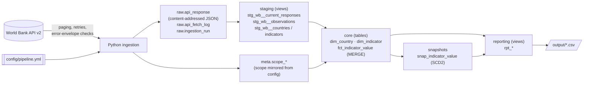

# World Bank indicators pipeline

A local, configuration-driven pipeline that pulls yearly country indicators from the public
[World Bank API v2](https://datahelpdesk.worldbank.org/knowledgebase/articles/889392), lands
every response unchanged in a raw layer, models the data with dbt on DuckDB, and publishes a small
reporting layer with automated data-quality checks.

**Scope (config):** BRA, CAN, DEU, GBR, IND, JPN, MEX, USA, ZAF ×
`SP.POP.TOTL`, `NY.GDP.MKTP.CD`, `NY.GDP.PCAP.CD`, `SP.DYN.LE00.IN` × 2018–2024.

**Stack:** Python 3.10+ (ingestion, CLI) · DuckDB (local warehouse) · dbt-core 1.12 + dbt-duckdb (models, snapshots, tests) · pytest.
No cloud resources, accounts or API keys.

---

## Quickstart

Run from a clean checkout. Python 3.10+ must be on your PATH. Each of these commands creates `.venv`, installs the package and runs the whole pipeline:

| Platform | Command |
|---|---|
| macOS / Linux | `make run` |
| Windows (PowerShell) | `.\run.ps1` |
| Docker | `docker build -t wb-pipeline . && docker run --rm -v "$PWD/output:/app/output" wb-pipeline` |

`run` does three things in order:

1. **ingest:** API → `raw.*`
2. **dbt build:** staging → core → snapshot → reporting, plus all data-quality tests
3. **export:** CSVs in [`output/`](output/)

The warehouse is the file `data/warehouse.duckdb`. You can query it with the DuckDB CLI or any DuckDB client.

```bash
make test                     # or .\run.ps1 test   -> 30 tests, no network access needed
wb-pipeline ingest            # API -> raw only
wb-pipeline transform         # rebuild everything from raw, no API calls (replay)
wb-pipeline export            # reporting views -> CSV
make docs                     # dbt docs + lineage graph in the browser
```

> The Dockerfile and `make` targets follow standard patterns, but they were not executed on the
> development machine (Windows, no Docker). `run.ps1`, the CLI and the test suite were run there.

---

## Architecture



| Layer | Schema | What it holds | Written by |
|---|---|---|---|
| Raw | `raw` | Every distinct API page, byte-for-byte, plus a log of every fetch and run | Python only |
| Scope | `meta` | Countries, indicators (with aggregation rule and valid range) and years from config | Python only |
| Staging | `staging` | Typed, trimmed, deduplicated rows parsed from the *current* payloads | dbt views |
| Core | `core` | Conformed dimensions and the fact table at a declared grain | dbt tables |
| History | `snapshots` | SCD2 versions of every fact row | dbt snapshot |
| Reporting | `reporting` | Answers to the four analytical questions, plus a revisions audit | dbt views |
| DQ | `dq_failures` | Failing rows of any failed test, for inspection (`store_failures`) | dbt tests |

---

## Data model

```mermaid
erDiagram
    dim_country ||--o{ fct_indicator_value : country_iso3
    dim_indicator ||--o{ fct_indicator_value : indicator_code
    fct_indicator_value ||--o{ snap_indicator_value : indicator_value_id
    raw_api_response ||--o{ fct_indicator_value : source_response_id

    dim_country {
        varchar country_iso3 PK
        varchar country_name
        varchar region_name
        varchar income_group_code
        varchar income_group_name
    }
    dim_indicator {
        varchar indicator_code PK
        varchar short_name UK
        varchar unit
        varchar aggregation_method
        varchar numerator_code
        varchar denominator_code
        varchar weight_code
    }
    fct_indicator_value {
        varchar indicator_value_id PK
        varchar country_iso3 BK
        varchar indicator_code BK
        int year BK
        double value
        bool is_missing
        varchar missing_reason
        varchar source_response_id
        varchar source_request_url
        varchar row_hash
    }
```

| Model | Grain | Business key | Notes |
|---|---|---|---|
| `dim_country` | 1 row per country in scope | `country_iso3` | Labels are trimmed (the API pads some region names with trailing spaces). Income group is the *current* WB classification. |
| `dim_indicator` | 1 row per indicator in scope | `indicator_code` | Config attributes (`short_name`, unit, aggregation rule, valid range) plus the API's own name, definition and source. |
| `fct_indicator_value` | 1 row per **country × indicator × year in scope** | (`country_iso3`, `indicator_code`, `year`) | This is the full expected spine, so missing combinations are rows too. Long format means a new indicator never changes the schema. |
| `snap_indicator_value` | 1 row per version of a fact row | `indicator_value_id` + `dbt_valid_from` | History of corrections, late values and withdrawals. |

Analysts query `core` and `reporting` and never touch JSON. Values are numeric `DOUBLE` in the
indicator's unit, years are integers, codes are upper-case ISO3/WB codes, and a missing value is
`NULL` with a reason, never `0`.

---

## Key decisions (walkthrough)

**1. The raw layer is content-addressed.**
`response_id = sha256(request_url, body)`. If a re-fetch returns the same bytes, nothing is
inserted. If the source changed, a new row is added and the old payload is kept.
`raw.api_fetch_log` records every fetch (run, request, page → response_id). The raw layer is
therefore an append-only, de-duplicated audit trail. You can rebuild everything downstream from
it without calling the API (`wb-pipeline transform`). Request URLs are built deterministically
(sorted parameters and country codes), so the same request always gets the same identity.

**2. Every value is traceable to its API response.**
Each fact row carries `source_response_id`, `source_request_url` (including the page) and
`source_run_id`. The test `assert_values_traceable_to_raw_payload` re-parses the referenced raw
payload and checks the value matches for every row, so lineage is verified, not just stored.

**3. Idempotency in two places.**
- **Raw:** see point 1.
- **Core:** `fct_indicator_value` is an incremental model that uses `MERGE` on the business key
  (the Snowflake pattern). Only rows whose business-content hash changed are sent to the merge.
  A re-run on unchanged data therefore updates **zero** rows, and `last_changed_at` stays put.
  A post-hook deletes keys that left the scope, so the table always equals the spine.
  This is proven by tests, and was also checked against the live API (second run: 0 new
  payloads, 0 changed rows).

**4. Atomic requests; failed runs are ignored downstream.**
All pages of a logical request are written in one transaction. Staging reads only payloads from
the latest *successful* run per request. A run that fails mid-way is recorded as `failed` with
its error, and it can never mix half-new and half-old data into the model.

**5. API failure handling.**
- **Errors returned as HTTP 200:** the World Bank returns errors with HTTP 200 and an envelope
  (`[{"message":[{"id":"120",...}]}]`). These are detected and treated as non-retryable.
- **Transient errors are retried** with exponential backoff and jitter: timeouts, connection
  errors, 408/425/429/5xx, and non-JSON bodies (the API sometimes serves HTML under load).
- **Other 4xx responses fail fast.**
- **Paging is checked:** after fetching all pages, the row count must equal `meta.total`. If the
  paging metadata changes mid-request, the request is rejected.
- `[meta, null]` is a valid empty result, not an error.

**6. Missing data is a first-class outcome.**
The spine (scope countries × indicators × years) is left-joined to the observations. Each missing
row gets one of two reasons:
- `null_in_source`: the API returned the row with `value: null`
- `not_returned_by_source`: the API did not return the row at all

`rpt_missing_data` also classifies each gap as one of `not_yet_published`, `gap_in_series`,
`before_series_start` or `no_data_in_scope`.

**7. Year-over-year rules.**
- Strict YoY always compares with `year − 1`. The spine guarantees that the previous row is the
  previous calendar year.
- `pct_change = (v − prior) / |prior|`. It is `NULL` when the current or prior value is missing,
  or the prior is 0. `yoy_status` gives the reason; `abs_change` is still reported when the
  prior is 0.
- For series with gaps, `annualised_pct_change_vs_last_available` compares with the last earlier
  year that has data (CAGR over the gap).

**8. "Latest available year" has two readings, and both are given.**
- `latest_year`: the latest year in which *any* selected country has data. Countries missing
  that year are flagged.
- `latest_complete_year`: the latest year in which *all* selected countries have data. This is
  the like-for-like ranking.

**9. Income-group aggregation is driven by config and never averages averages.**
- Population and GDP are **summed**.
- GDP per capita is **Σ GDP / Σ population**.
- Life expectancy is a **population-weighted mean**.

Only countries with every input present contribute, and `countries_contributing` vs
`countries_in_group` (`is_complete`) makes partial coverage visible. The difference matters: in
2024 the selected countries' GDP per capita is **20,795 USD** aggregated correctly, against
35,287 USD as a naive average of the nine country values.

**10. Adding a country or indicator is a config change only.**
Edit `config/pipeline.yml`:
- Add an ISO3 code under `countries`, or
- Add an indicator block with `code`, `short_name`, `unit`, `aggregation` and an optional
  `valid_range`.

The ingestion mirrors the scope into `meta.scope_*` and every model, test and report picks it up.
A new `ratio` indicator is automatically covered by the reconciliation test. Removing an item
removes its rows from the fact table and closes them in the snapshot (covered by
`test_adding_and_removing_a_country_is_config_only`).

---

## Data quality & tests

**dbt tests (53, run on every `dbt build`).** Tests with severity *error* stop the build, and
then no CSVs are exported.

| Check | Type | Severity |
|---|---|---|
| PK unique / not null; FK relationships fact → dims; accepted values (reasons, statuses, income groups, aggregation methods) | generic | error |
| Grain: unique (country, indicator, year) in fact and reports | generic | error |
| **Spine completeness**: fact = scope countries × indicators × years, no more, no less | singular | error |
| **Missing-flag semantics**: `is_missing ⇔ value is null ⇔ missing_reason is not null`, lineage consistent with the reason | singular | error |
| **Traceability**: every value equals the value in the raw payload it points to | singular | error |
| **Configured valid ranges** per indicator (catches unit/scale errors) | singular | error |
| **Cross-indicator consistency**: every `ratio` indicator reconciles with its components (GDP per capita = GDP / population, tolerance 0.5%; the live data reconciles exactly) | singular | error |
| Ratio indicator present while a component is missing (or vice versa) | singular | warn |
| Population moving > 5% YoY | singular | warn |
| API returned rows outside the requested scope or non-annual periods | singular | warn |
| Every scope country has metadata and an income group | generic | error |

The outcome of each test is exported to [`output/dq_test_results.csv`](output/dq_test_results.csv).

**pytest (30 tests, offline).**
[`tests/fake_api.py`](tests/fake_api.py) is an in-memory World Bank API that uses the real wire
format. It honours `per_page`/`page` and can script failures. No test calls the live API.

| Area | Proves |
|---|---|
| `test_api_client.py` | paging across 5 pages; deterministic URLs; HTTP-200 error envelopes; retry with exponential backoff; give-up after max retries; 4xx fail-fast; row-count reconciliation; paging metadata changing mid-request; empty results |
| `test_config.py` | validation of codes, year ranges, aggregation references, unknown keys |
| `test_ingest.py` | unchanged rerun stores no new payloads; a revision is stored as a new version; a failed run leaves no partial request and is recorded |
| `test_pipeline_e2e.py` (runs real dbt against a temp DuckDB) | **idempotent rerun (zero rows touched)**; null vs not-returned semantics; zero prior → NULL pct; **late value + revision → MERGE touches exactly 2 rows, snapshot and revisions report capture both**; inconsistent GDP per capita and out-of-range values **fail the build**; component gap → warning; add/remove a country via config; CSV export |

---

## Analytics outputs

Sample outputs from a live run on 2026-11-06 (source `lastupdated` 2026-10-08) are in [`output/`](output/):

| Question | View → CSV |
|---|---|
| Which country-indicator-year combinations are missing or incomplete? | `rpt_missing_data` (row level, with reason and gap type), `rpt_coverage_summary` (per series: completeness %, missing years, status) |
| Year-over-year change, handling missing/zero priors | `rpt_yoy_change` |
| Country comparison for the latest available year | `rpt_latest_year_comparison` (rank, ratio to peer median, at latest-any and latest-complete year, plus each country's own latest) |
| Indicators across income groups, by year | `rpt_income_group_by_year` (+ an "All selected countries" row) |
| *Extra:* source corrections / late data between runs | `rpt_source_revisions` |

The current World Bank release is **complete** for this scope (all 252 combinations have a
value). So `rpt_missing_data.csv` and `rpt_source_revisions.csv` contain only headers, and every
series in `rpt_coverage_summary.csv` is `complete`. These are real results, not a bug: missing,
late and revised data are exercised by the e2e tests with controlled fixtures.

---

## Assumptions

- **Income groups:** the API exposes only the *current* income classification, and it is applied
  to all years. Historical classifications (World Bank OGHIST file) are out of scope.
- **"Latest available year":** interpreted in the two ways described in decision 8.
- **YoY for 2018:** the first year in scope has no prior in scope (`no_prior_year_in_scope`). It
  is not fetched from 2017, so the dataset stays strictly within the requested years.
- **Units:** taken from config, because the API's `unit` field is empty for these indicators.
  Values are kept at full precision; `decimal` from the API is retained.
- **Revisions:** a re-published *identical* value is not a change. The fact row keeps pointing at
  the original response, which still contains that value.

## Trade-offs

- **DuckDB over Postgres/Snowflake locally:** zero-ops, a single file, and SQL close to
  Snowflake's (`QUALIFY`, `MERGE`, JSON paths). It is single-writer, which is fine here.
- **dbt, even at this size:** it brings declared grain/tests, lineage, docs, snapshots and the
  incremental-MERGE pattern that carry straight to production. The cost is about 3 seconds of
  parse time and a heavier install.
- **Incremental MERGE on a 252-row table:** a full rebuild would be simpler. MERGE was chosen
  deliberately to show the production pattern and to make "no duplicates, no needless updates"
  testable. `--full-refresh` is always safe because raw holds everything.
- **JSON stored in the warehouse, not in files:** simpler locally. In production the raw
  payloads go to object storage (see below).
- **No dbt packages (e.g. dbt_utils):** the one generic test needed is inlined, so the project
  builds fully offline.
- **Snapshot granularity:** history is only as fine as the run cadence. A change and its
  reversal between two runs is not seen. Raw payloads still allow reconstruction.
- **Integration tests run real dbt (about 2 minutes):** slower than mocks, but they test the
  actual SQL.

---

## Production design note

**Scheduling & incremental refreshes**
- Orchestrate as an Airflow/Dagster DAG: `ingest[indicator]` (mapped per indicator) →
  `dbt build` → publish/export. Use a daily schedule plus manual trigger.
- WDI releases are infrequent, so each run first makes a cheap probe (`per_page=1`) per
  indicator and compares `lastupdated` with the last successful run. Only changed indicators are
  re-fetched. Content addressing keeps a redundant fetch harmless anyway.
- Always re-fetch the full configured year window (or a rolling 10-year look-back), because the
  World Bank revises history. Never treat past years as closed.
- Use `dbt build --select state:modified+` / source-freshness-based selection so only affected
  models are rebuilt.

**Late, corrected or changed source data**
- Detection is built in: a changed payload gets a new `response_id`. The MERGE updates only rows
  whose content hash changed; `last_changed_at` records when.
- The SCD2 snapshot keeps every prior version (as-of queries; Snowflake Time Travel for
  short-term).
- `rpt_source_revisions` becomes a change feed. Revisions above a threshold, e.g. >2% on a
  published KPI, notify report owners, because a number in last month's deck changing is a
  business event, not a technical one.

**Monitoring, alerting & DQ failures**
- `raw.ingestion_run` + dbt `run_results.json` → a metrics table: duration, pages, new payloads,
  rows changed, test outcomes.
- Alert, routed to the owning team's channel and on-call, on:
  - run failure
  - any error-severity test
  - freshness SLA breach (no successful run in N days, or source `lastupdated` older than
    expected)
  - volume anomalies (rows changed ≫ usual, fewer rows returned than last run)
- **Write-audit-publish:** build into a staging schema (or zero-copy clone) and swap into the
  consumer schema only if the error tests pass. Consumers then never see bad data; they see
  yesterday's good data plus an alert. Warnings go to a daily digest with failing rows from
  `dq_failures`.

**Backfills & replay-ability**
- Raw is immutable and content-addressed, so any downstream state can be rebuilt without the
  API: `wb-pipeline transform` (`--full-refresh` for core).
- **Backfilling years or countries is a config change**, followed by a run. The MERGE inserts
  the new keys only.
- To reproduce a past report, rebuild from the payloads fetched up to a given `run_id` (the fetch
  log has this) into an isolated schema. The config fingerprint stored with each run records
  which scope was in force.

**Mapping to Snowflake + AWS Glue/EMR (or Azure)**

| Local | AWS + Snowflake | Azure equivalent |
|---|---|---|
| Python ingestion | AWS Glue Python-shell job (or Lambda/ECS task); Spark (Glue/EMR) only if scope grew to all ~1.5k indicators × 260 economies | Azure Functions / ADF + Databricks if Spark is needed |
| `raw.api_response` | S3 landing `s3://…/worldbank/{endpoint}/{run_date}/{sha256}.json` (immutable, versioned) → external stage → Snowpipe/`COPY INTO` a `VARIANT` raw table | ADLS Gen2 → Snowflake on Azure / Synapse |
| `raw.api_fetch_log`, `ingestion_run` | Snowflake tables written by the job | same |
| dbt-duckdb | dbt Core (MWAA/ECS) or dbt Cloud on Snowflake; same models. JSON paths become `payload:field::type`, `unnest` becomes `LATERAL FLATTEN` | dbt on Snowflake/Databricks |
| Incremental MERGE | Native Snowflake `MERGE`. Alternative: a Stream on the raw table + Task, for event-driven loads without an orchestrator | Delta `MERGE` |
| Snapshot | dbt snapshot (or Streams → SCD2 table) + Time Travel | Delta time travel |
| Scheduling | MWAA (Airflow) or Dagster; Snowflake Tasks for in-warehouse steps | ADF / Fabric pipelines |
| Compute | XS warehouse, `AUTO_SUSPEND=60`; separate transform and BI warehouses; resource monitors for cost | — |
| Reporting | The `core` star (dim_country, dim_indicator, fct) maps directly to a Power BI model (import mode); `reporting` views for ad-hoc SQL | Power BI / Fabric |

Clustering is unnecessary at this volume. At scale, cluster the fact table on
`(indicator_code, year)` to match the dominant filters.

---

## AI usage

This project was built in a pair-programming session with **Claude Code** (Anthropic).

AI was used to:
- probe the live API and surface its quirks (errors returned with HTTP 200, padded labels)
- scaffold the package, dbt project and tests
- draft documentation

Design choices were discussed and steered explicitly; the job description's emphasis on grain,
MERGE patterns, late data and testing shaped the scope. The principle was: **don't trust,
verify**:
- Every behavioural claim in this README is backed by a test or by a run against the live API.
  Examples: zero-row reruns, exact GDP-per-capita reconciliation, 30 passing tests.
- Two real defects were caught this way during development:
  - an escaped newline in a SQL comment that broke the DDL
  - a test fake that mis-parsed `;` in URLs

---

## Unfinished work / next steps

- `lastupdated` probe for incremental fetches (designed above, not implemented). Every run
  currently re-fetches the full scope (9 small requests).
- Write-audit-publish swap and source-freshness checks.
- A `--as-of-run` replay flag (the data needed for it is already in `raw.api_fetch_log`).
- Historical income classifications (OGHIST) to make income-group trends era-correct.
- Power BI model on top of `core` (optional in the brief; not started).
- CI is defined in `.github/workflows/ci.yml`, but it has not run until the repo is pushed.

## Repository layout

```
config/pipeline.yml        scope, source, quality settings (single source of truth)
src/wb_pipeline/           config.py · api_client.py · ingest.py · transform.py · export.py · cli.py
dbt/models/staging/        sources + parsing of raw JSON
dbt/models/core/           dim_country, dim_indicator, fct_indicator_value (+ _core.yml contracts)
dbt/models/reporting/      rpt_* views (+ _reporting.yml)
dbt/snapshots/             snap_indicator_value (SCD2)
dbt/tests/                 singular data-quality tests
tests/                     pytest suite + fake World Bank API
output/                    sample CSV outputs and DQ results
```
