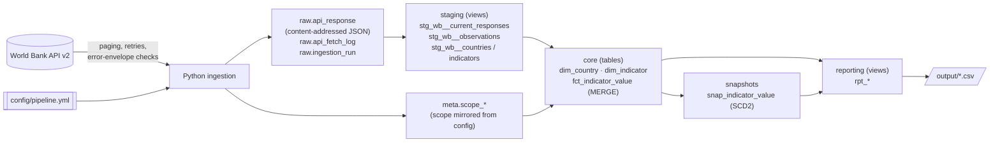
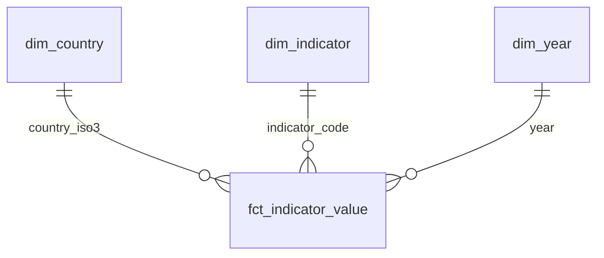

# World Bank indicators pipeline

A local, configuration-driven pipeline that pulls yearly country indicators from the public
[World Bank API v2](https://datahelpdesk.worldbank.org/knowledgebase/articles/889392), lands
every response unchanged in a raw layer, models the data with dbt on DuckDB, and publishes a small
reporting layer with automated data-quality checks.

**Scope (config):** BRA, CAN, DEU, GBR, IND, JPN, MEX, USA, ZAF ×
`SP.POP.TOTL`, `NY.GDP.MKTP.CD`, `NY.GDP.PCAP.CD`, `SP.DYN.LE00.IN` × 2018–2024.

**Stack:** Python 3.11+ (ingestion, CLI; developed and tested on 3.12) · DuckDB (local warehouse) · dbt-core 1.12 + dbt-duckdb (models, snapshots, tests) · pytest.
No cloud resources, accounts or API keys.

---

## Quickstart

**Prerequisites:** Python 3.11+ (tested with 3.12) and internet access to `api.worldbank.org`.
Nothing else: no Docker, `make`, accounts or API keys.

From a clean checkout, run **one command**, the same on Windows, macOS and Linux:

```bash
python run.py
```

Use `python3 run.py` if `python` on your system is not Python 3.

On the first run, `run.py` creates `.venv` and installs the package with the exact tested
dependency versions from `constraints.txt`. It uses only the Python standard library. Then it
runs the pipeline:

1. **ingest:** API → `raw.*`
2. **dbt build:** staging → core → snapshot → reporting, plus all 65 data-quality tests
3. **export:** CSVs and `_manifest.json` in [`output/`](output/)

Running it again is safe. Unchanged source data creates no new payloads and changes no rows.
The committed sample in `output/` is regenerated on every run. With unchanged source data the
CSVs come out byte-identical; only `output/_manifest.json` changes, because it records the new
run id and timestamp.
The warehouse is the file `data/warehouse.duckdb`; you can query it with the DuckDB CLI or any
DuckDB client.

The same entry point runs everything else. No virtualenv activation is needed:

```bash
python run.py test        # 52 offline tests (all network access is blocked in tests)
python run.py lint        # ruff check + format check
python run.py ingest      # API -> raw only
python run.py transform   # rebuild everything from raw, no API calls (replay)
python run.py transform --full-refresh   # ... also rebuilding the MERGE-loaded fact from scratch
python run.py export      # reporting views -> CSV
python run.py docs        # dbt docs + lineage graph on http://localhost:8080
```

**Optional: Docker**, if you prefer not to use a local Python:

```bash
docker build -t wb-pipeline .
docker run --rm -v "${PWD}/output:/app/output" wb-pipeline
```

> **How this was verified.** `python run.py` and `python run.py test` were run from a fresh
> `git clone` on Windows 11 with Python 3.12, following this section literally.
> CI ([`.github/workflows/ci.yml`](.github/workflows/ci.yml)) repeats it on every push:
> - `python run.py` from a clean checkout on Ubuntu, macOS and Windows, against the live API,
>   followed by an idempotency re-run
> - `python run.py lint` and `python run.py test`
> - the Docker build and the tests inside the container. Docker was not available on the
>   development machine, so CI is where the Docker path is verified.

---

## Requirements checklist

| Brief requirement | Where | Evidence |
|---|---|---|
| Country metadata + indicator observations | `api_client.py` (`fetch_countries`, `fetch_indicator_metadata`, `fetch_observations`) | live run: 9 requests |
| Paging | `_fetch_all_pages`: follows `meta.pages`, checks rows = `meta.total`, rejects metadata changing mid-request | `test_paging_collects_every_page` (5 pages); verified live with `per_page=20` (4 pages, 63 unique rows) |
| API failures | retries with backoff for timeouts, 429/5xx and non-JSON; HTTP-200 error envelopes; 4xx fail fast; atomic per-request writes; failed runs ignored downstream | 9 client tests, `test_failed_run_*`, `test_unreachable_source_fails_cleanly_*` |
| Every output value traceable to its API response | `source_response_id` on fact **and on every reporting view**; `output/_manifest.json` ties CSVs to `run_id` + source `lastupdated` | DQ test `assert_values_traceable_to_raw_payload` re-parses the payload per value; `test_export_writes_manifest_*` |
| Single documented command from a clean checkout | `python run.py`, the same on every OS; Docker as an optional alternative | clean-clone run (Windows); CI runs it on Ubuntu, macOS and Windows, plus a `docker` job |
| Any stack; runs locally by following the README | Python + DuckDB + dbt, all local; [Quickstart](#quickstart) is the only setup | the CI steps are the README commands, verbatim |
| Re-run creates no duplicates | content-addressed raw + MERGE on business key, updating only changed rows | `test_full_build_then_rerun_is_idempotent` (0 rows touched); CI re-run check; live: 0 new payloads |
| No cloud / paid / API accounts | public API only, local DuckDB file | dbt telemetry disabled; tests block all sockets |
| Raw separate from clean and analytics data | schemas `raw` → `staging` → `core` → `reporting` | [Architecture](#architecture) |
| Grain, keys, relationships documented | [Data model](#data-model), `_core.yml` | grain, unique-key, relationship and spine tests |
| Standardised for analysts | typed, trimmed, ISO3 codes; long fact table plus dims; missing = `NULL` + reason | [Data model](#data-model) |
| Add a country / indicator by config | `config/pipeline.yml` → `meta.scope_*` → every model and test | `test_adding_and_removing_a_country_is_config_only`, `test_adding_an_indicator_is_config_only` |
| Q1 missing / incomplete | `rpt_missing_data`, `rpt_coverage_summary` | `test_missing_values_are_explicit_never_zero` |
| Q2 YoY with missing / zero priors | `rpt_yoy_change` | `test_zero_prior_value_gives_null_pct_change` and the missing-data test |
| Q3 latest-year comparison | `rpt_latest_year_comparison` | missing-data test (latest-any vs latest-complete) |
| Q4 income groups by year | `rpt_income_group_by_year` | weighted aggregation asserted in `test_adding_an_indicator_*` |
| Automated DQ checks; related indicators consistent | 65 dbt tests incl. ratio reconciliation and coverage | `test_inconsistent_related_indicators_fail_the_build`, `test_out_of_range_*`, `test_tampered_raw_payload_*` |
| Tests run without the live API | `tests/fake_api.py`; autouse fixture blocks every socket | `test_unreachable_source_*` asserts the guard fired |
| Production note | [Production design note](#production-design-note) | — |
| README: setup, assumptions, trade-offs, walkthrough, AI usage | this file | — |
| Sample output | [`output/`](output/) (CSV + `_manifest.json` + `dq_test_results.csv`) | — |
| Git repo with history | one commit per milestone | `git log` |
| *Optional:* extra view / dashboard / Power BI | `rpt_source_revisions`; Power BI project in [`powerbi/`](powerbi/) | `test_powerbi_model.py` (model ↔ export contract); verified in Power BI Desktop with `powerbi/verify_model.ps1` (112/112 and 252/252 values match SQL) |

---

## Architecture



| Layer | Schema | What it holds | Written by |
|---|---|---|---|
| Raw | `raw` | Every distinct API page, byte-for-byte, plus a log of every fetch and run | Python only |
| Scope | `meta` | Countries, indicators (with aggregation rule and valid range) and years from config | Python only |
| Staging | `staging` | Typed, trimmed, deduplicated rows parsed from the *current* payloads | dbt views |
| Core | `core` | Conformed dimensions and the fact table at a declared grain | dbt tables |
| History | `snapshots` | SCD2 versions of every fact row | dbt snapshot |
| Reporting | `reporting` | Answers to the four analytical questions, plus a revisions audit | dbt views |
| DQ | `dq_failures` | Failing rows of any failed test, for inspection (`store_failures`) | dbt tests |

---

## Data model

```mermaid
erDiagram
    dim_country ||--o{ fct_indicator_value : country_iso3
    dim_indicator ||--o{ fct_indicator_value : indicator_code
    fct_indicator_value ||--o{ snap_indicator_value : indicator_value_id
    raw_api_response ||--o{ fct_indicator_value : source_response_id

    dim_country {
        varchar country_iso3 PK
        varchar country_name
        varchar region_name
        varchar income_group_code
        varchar income_group_name
    }
    dim_indicator {
        varchar indicator_code PK
        varchar short_name UK
        varchar unit
        varchar aggregation_method
        varchar numerator_code
        varchar denominator_code
        varchar weight_code
    }
    fct_indicator_value {
        varchar indicator_value_id PK
        varchar country_iso3 BK
        varchar indicator_code BK
        int year BK
        double value
        bool is_missing
        varchar missing_reason
        varchar source_response_id
        varchar source_request_url
        varchar row_hash
    }
```

| Model | Grain | Business key | Notes |
|---|---|---|---|
| `dim_country` | 1 row per country in scope | `country_iso3` | Labels are trimmed (the API pads some region names with trailing spaces). Income group is the *current* WB classification. |
| `dim_indicator` | 1 row per indicator in scope | `indicator_code` | Config attributes (`short_name`, unit, aggregation rule, valid range) plus the API's own name, definition and source. |
| `fct_indicator_value` | 1 row per **country × indicator × year in scope** | (`country_iso3`, `indicator_code`, `year`) | This is the full expected spine, so missing combinations are rows too. Long format means a new indicator never changes the schema. |
| `snap_indicator_value` | 1 row per version of a fact row | `indicator_value_id` + `dbt_valid_from` | History of corrections, late values and withdrawals. |

Analysts query `core` and `reporting` and never touch JSON. Values are numeric `DOUBLE` in the
indicator's unit, years are integers, codes are upper-case ISO3/WB codes, and a missing value is
`NULL` with a reason, never `0`.

---

## Key decisions (walkthrough)

**1. The raw layer is content-addressed.**
`response_id = sha256(request_url, body)`. If a re-fetch returns the same bytes, nothing is
inserted. If the source changed, a new row is added and the old payload is kept.
`raw.api_fetch_log` records every fetch (run, request, page → response_id). The raw layer is
therefore an append-only, de-duplicated audit trail. You can rebuild everything downstream from
it without calling the API (`python run.py transform`). Request URLs are built deterministically
(sorted parameters and country codes), so the same request always gets the same identity.

**2. Every value is traceable to its API response.**
Each fact row carries `source_response_id`, `source_request_url` (including the page) and
`source_run_id`. The test `assert_values_traceable_to_raw_payload` re-parses the referenced raw
payload and checks the value matches for every row, so lineage is verified, not just stored.

The reporting views carry lineage too:
- `rpt_yoy_change`: `source_response_id` and `prior_source_response_id`
- `rpt_latest_year_comparison`: the response behind each compared value
- `rpt_income_group_by_year`: `source_response_ids` of the inputs actually used
- `rpt_missing_data`: the request URLs that were checked, as proof of absence

`output/_manifest.json` records which ingestion run, config fingerprint and source `lastupdated`
the CSVs were built from. To trace a number from any CSV back to the exact API response:

```sql
select r.request_url, r.source_last_updated, r.first_fetched_at, r.payload
from raw.api_response r
where r.response_id = '<source_response_id from the CSV>';
```

**3. Idempotency in two places.**
- **Raw:** see point 1.
- **Core:** `fct_indicator_value` is an incremental model that uses `MERGE` on the business key
  (the Snowflake pattern). Only rows whose business-content hash changed are sent to the merge.
  A re-run on unchanged data therefore updates **zero** rows, and `last_changed_at` stays put.
  A post-hook deletes keys that left the scope, so the table always equals the spine.
  This is proven by tests, and was also checked against the live API (second run: 0 new
  payloads, 0 changed rows).

**4. One consistent source snapshot; failed runs are ignored downstream.**
All pages of a logical request are written in one transaction. Staging reads exactly the
payloads of the latest *successful* run. Every run fetches the full scope, so:
- GDP, population and GDP per capita always come from the same moment, which makes the
  cross-indicator checks meaningful;
- a run that fails mid-way (recorded as `failed` with its error) can never mix new and old data;
- a value the source withdraws can never be resurrected from an older request (regression test
  `test_scope_change_never_resurrects_values_from_older_requests`).

**5. API failure handling.**
- **Errors returned as HTTP 200:** the World Bank returns errors with HTTP 200 and an envelope
  (`[{"message":[{"id":"120",...}]}]`). These are detected and treated as non-retryable.
- **Transient errors are retried** with exponential backoff and jitter: timeouts, connection
  errors, 408/425/429/5xx, and non-JSON bodies (the API sometimes serves HTML under load).
- **Other 4xx responses fail fast.**
- **Paging is checked:** after fetching all pages, the row count must equal `meta.total`. If the
  paging metadata changes mid-request, the request is rejected.
- `[meta, null]` is a valid empty result, not an error.

**6. Missing data is a first-class outcome.**
The spine (scope countries × indicators × years) is left-joined to the observations. Each missing
row gets one of two reasons:
- `null_in_source`: the API returned the row with `value: null`
- `not_returned_by_source`: the API did not return the row at all

`rpt_missing_data` also classifies each gap as one of `not_yet_published`, `gap_in_series`,
`before_series_start` or `no_data_in_scope`.

**7. Year-over-year rules.**
- Strict YoY always compares with `year − 1`. The spine guarantees that the previous row is the
  previous calendar year.
- `pct_change = (v − prior) / |prior|`. It is `NULL` when the current or prior value is missing,
  or the prior is 0. `yoy_status` gives the reason; `abs_change` is still reported when the
  prior is 0.
- For series with gaps, `annualised_pct_change_vs_last_available` compares with the last earlier
  year that has data (CAGR over the gap).

**8. "Latest available year" has two readings, and both are given.**
- `latest_year`: the latest year in which *any* selected country has data. Countries missing
  that year are flagged.
- `latest_complete_year`: the latest year in which *all* selected countries have data. This is
  the like-for-like ranking.

**9. Income-group aggregation is driven by config and never averages averages.**
- Population and GDP are **summed**.
- GDP per capita is **Σ GDP / Σ population**.
- Life expectancy is a **population-weighted mean**.

Only countries with every input present contribute, and `countries_contributing` vs
`countries_in_group` (`is_complete`) makes partial coverage visible. The difference matters: in
2024 the selected countries' GDP per capita is **20,795 USD** aggregated correctly, against
35,287 USD as a naive average of the nine country values.

**10. Adding a country or indicator is a config change only.**
Edit `config/pipeline.yml`, then run `python run.py`:
- Add an ISO3 code under `countries`, or
- Add an indicator block with `code`, `short_name`, `unit`, `aggregation`, and optionally
  `valid_range` and `max_abs_yoy_change`. For example:

```yaml
    - code: SP.URB.TOTL.IN.ZS              # urban population, % of total
      short_name: urban_population_pct
      unit: "% of population"
      aggregation: {method: weighted_avg, weight: SP.POP.TOTL}
      valid_range: {min: 0, max: 100}
```

The ingestion mirrors the scope into `meta.scope_*` and every model, test and report picks it up.
A new `ratio` indicator is automatically covered by the reconciliation test. Removing an item
removes its rows from the fact table and closes them in the snapshot. This is covered by
`test_adding_and_removing_a_country_is_config_only` and `test_adding_an_indicator_is_config_only`;
the latter adds urban population % and checks its population-weighted income-group aggregate.

---

## Data quality & tests

**dbt tests (65, run on every `dbt build`).** Tests with severity *error* stop the build, and
then no CSVs are exported.

| Check | Type | Severity |
|---|---|---|
| PK unique / not null; FK relationships fact → dims; accepted values (reasons, statuses, income groups, aggregation methods) | generic | error |
| Grain: unique keys in staging, fact and every report | generic | error |
| **Raw integrity**: stored payload hashes to its `payload_sha256`; every successful run logged all pages of each request | singular | error |
| **Spine completeness**: fact = scope countries × indicators × years, no more, no less | singular | error |
| **Missing-flag semantics**: `is_missing ⇔ value is null ⇔ missing_reason is not null`, lineage consistent with the reason | singular | error |
| **Traceability**: every value equals the value in the raw payload it points to | singular | error |
| **Configured valid ranges** per indicator (catches unit/scale errors) | singular | error |
| **Cross-indicator consistency**: every `ratio` indicator reconciles with its components (GDP per capita = GDP / population, tolerance 0.5%; the live data reconciles exactly) | singular | error |
| Ratio indicator present while a component is missing (or vice versa) | singular | warn |
| YoY move larger than the indicator's configured `max_abs_yoy_change` (population 5%, life expectancy 10%) | singular | warn |
| API returned rows outside the requested scope or non-annual periods | singular | warn |
| Every scope country has metadata and an income group | generic | error |

The outcome of each test is exported to [`output/dq_test_results.csv`](output/dq_test_results.csv).

**pytest (52 tests, offline).**
[`tests/fake_api.py`](tests/fake_api.py) is an in-memory World Bank API that uses the real wire
format. It honours `per_page`/`page` and can script failures. An autouse fixture blocks every outbound socket, so a test that tried to reach the internet would fail.

| Area | Proves |
|---|---|
| `test_api_client.py` | paging across 5 pages; deterministic URLs; HTTP-200 error envelopes; retry with exponential backoff; give-up after max retries; 4xx fail-fast; row-count reconciliation; paging metadata changing mid-request; empty results |
| `test_config.py` | validation of codes, year ranges, aggregation references, unknown keys |
| `test_ingest.py` | unchanged rerun stores no new payloads; a revision is stored as a new version; a failed run leaves no partial request and is recorded |
| `test_cli.py` | every exit code: 0 (run publishes CSVs, manifest, star schema), 1 (a failing DQ test publishes nothing), 2 (bad config, transform before ingest), 3 (unreachable source, run recorded as failed); `transform --full-refresh` replays from raw without calling the API |
| `test_powerbi_model.py` | Power BI model ↔ export contract: every model column exists in the exported CSV (same order), relationships hit real columns, measures reference only model objects, project JSON is valid, TMDL uses tabs; regressions for the two Desktop-only issues (reserved DAX variable names, shared M function) |
| `test_pipeline_e2e.py` (runs real dbt against a temp DuckDB) | **idempotent rerun (zero rows touched)**; null vs not-returned semantics; zero prior → NULL pct; **late value + revision → MERGE touches exactly 2 rows, snapshot and revisions report capture both**; value withdrawn → `not_returned_by_source` + audited; no resurrection after a scope change; inconsistent GDP per capita, out-of-range values and a tampered raw payload **fail the build**; component gap → warning; add/remove a country and add an indicator via config; an indicator with no data stays visible as missing in every report; CSV export + manifest + lineage |

---

## Analytics outputs

Sample outputs from a live run on 2026-11-06 (source `lastupdated` 2026-10-08) are in [`output/`](output/):

| Question | View → CSV |
|---|---|
| Which country-indicator-year combinations are missing or incomplete? | `rpt_missing_data` (each *missing* combination, with reason, gap type and the checked request), `rpt_coverage_summary` (each *incomplete* series: completeness %, missing years, status) |
| Year-over-year change, handling missing/zero priors | `rpt_yoy_change` |
| Country comparison for the latest available year | `rpt_latest_year_comparison` (rank, ratio to peer median, at latest-any and latest-complete year, plus each country's own latest) |
| Indicators across income groups, by year | `rpt_income_group_by_year` (+ an "All selected countries" row and `ratio_to_all_selected`) |
| *Extra:* source corrections / late data between runs | `rpt_source_revisions` |

The current World Bank release is **complete** for this scope (all 252 combinations have a
value). So `rpt_missing_data.csv` and `rpt_source_revisions.csv` contain only headers, and every
series in `rpt_coverage_summary.csv` is `complete`. These are real results, not a bug: missing,
late and revised data are exercised by the e2e tests with controlled fixtures.

---

## Power BI model (optional extra)

[`powerbi/WorldBankIndicators.pbip`](powerbi/) is a Power BI Project. The semantic model is
stored as code in TMDL, so it is reviewable and diffable like the rest of the repo.

**Model:** a star schema, with the same grain and keys as the warehouse.



- `python run.py` exports the tables to [`output/powerbi/`](output/powerbi/): `dim_country`,
  `dim_indicator`, `dim_year` and `fct_indicator_value`.
- Relationships are many-to-one and single-direction.
- Foreign keys and raw values are hidden, so report authors use the dimensions and measures.
- Implicit measures are disabled, so summing values of different indicators by accident is not
  possible.
- Lineage columns (`source_response_id`, `source_request_url`, `source_last_updated`) stay
  visible for drill-through.

**Measures:**

| Measure | Logic |
|---|---|
| `Indicator Value` | Uses the indicator's configured rule, the same as `rpt_income_group_by_year`: sum (population, GDP), Σ GDP / Σ population (GDP per capita), or population-weighted mean (life expectancy). Only country-years with every input present contribute. Blank if several indicators are in context. |
| `Simple Average` | Plain average of country values, to show the difference from a correct aggregate. |
| `YoY %` | Strict change vs `year − 1`. Blank when either year is missing or the prior value is 0. |
| `Countries Reporting`, `Missing Combinations`, `Completeness %`, `Latest Year With Data` | Coverage and missing data (Q1). |

**Data source:** the `DataFolder` parameter. Its default is the sample CSVs in this public
repo, so the model opens without running the pipeline. After a local run, point it at your
`output/powerbi/` folder (**Transform data → Edit parameters**, keep the trailing slash).

**To open:** use Power BI Desktop (Windows, free).
1. Open `powerbi/WorldBankIndicators.pbip`.
2. Click **Refresh**. If asked about access to `raw.githubusercontent.com`, choose **Anonymous**.

**Checking the measures:** put `dim_country[income_group_name]` and `dim_year[year]` in a matrix,
filter on one `dim_indicator[short_name]`, and add `Indicator Value`. The numbers should match
`output/rpt_income_group_by_year.csv`. For example, GDP per capita in 2024: HIC 67,076.91,
UMC 10,857.25, LMC 2,591.99; all selected countries 20,795.23, against a `Simple Average` of
35,287.25.

**How it was verified.** The project was opened in Power BI Desktop (September 2026 release).
[`powerbi/verify_model.ps1`](powerbi/verify_model.ps1) then connected to Desktop's local
Analysis Services engine, the same way DAX Studio and Tabular Editor do, and checked:
- **Load:** all 4 tables loaded (9 / 4 / 7 / 252 rows), with no load or measure errors.
- **`Indicator Value` and `Simple Average`:** match `rpt_income_group_by_year` for
  **112/112** income group × indicator × year values.
- **`YoY %` and country values:** match `rpt_yoy_change` for **252/252** values.
- **Indicator guard:** `Indicator Value` is blank when several indicators are in context.

To repeat the check, open the `.pbip`, then run:

```powershell
powershell -ExecutionPolicy Bypass -File powerbi\verify_model.ps1
```

Two issues that only Desktop could reveal were found and fixed this way, and both are now
regression tests in `test_powerbi_model.py`:
- `cells` is reserved in DAX, so all DAX variables now use the `_name` convention.
- A shared M helper function caused a cyclic-reference error, so each table query now reads
  its own CSV.

---

## Assumptions

- **Income groups:** the API exposes only the *current* income classification, and it is applied
  to all years. Historical classifications (World Bank OGHIST file) are out of scope.
- **"Missing" vs "incomplete":** a *missing* combination has no value: it was null in the
  source or not returned. An *incomplete* series is a country × indicator with at least one
  missing year in scope. Both are reported, at their own grain.
- **"Latest available year":** interpreted in the two ways described in decision 8.
- **YoY for 2018:** the first year in scope has no prior in scope (`no_prior_year_in_scope`). It
  is not fetched from 2017, so the dataset stays strictly within the requested years.
- **Units:** taken from config, because the API's `unit` field is empty for these indicators.
  Values are kept at full precision; `decimal` from the API is retained.
- **Scope changes take effect on ingest:** the ingestion writes the configured scope into
  `meta.scope_*`. After editing `config/pipeline.yml`, run `python run.py`, not only
  `transform`; `transform` rebuilds from raw for the scope of the last successful ingestion.
- **Revisions:** a re-published *identical* value is not a change. The fact row keeps pointing at
  the original response, which still contains that value.

## Trade-offs

- **DuckDB over Postgres/Snowflake locally:** zero-ops, a single file, and SQL close to
  Snowflake's (`QUALIFY`, `MERGE`, JSON paths). It is single-writer, which is fine here.
- **dbt, even at this size:** it brings declared grain/tests, lineage, docs, snapshots and the
  incremental-MERGE pattern that carry straight to production. The cost is about 3 seconds of
  parse time and a heavier install.
- **Incremental MERGE on a 252-row table:** a full rebuild would be simpler. MERGE was chosen
  deliberately to show the production pattern and to make "no duplicates, no needless updates"
  testable. `--full-refresh` is always safe because raw holds everything.
- **JSON stored in the warehouse, not in files:** simpler locally. In production the raw
  payloads go to object storage (see below).
- **No dbt packages (e.g. dbt_utils):** the one generic test needed is inlined, so the project
  builds fully offline.
- **Snapshot granularity:** history is only as fine as the run cadence. A change and its
  reversal between two runs is not seen. Raw payloads still allow reconstruction.
- **Integration tests run real dbt (about 3 minutes):** slower than mocks, but they test the
  actual SQL.

---

## Production design note

**Scheduling & incremental refreshes**
- Orchestrate as an Airflow/Dagster DAG: `ingest[indicator]` (mapped per indicator) →
  `dbt build` → publish/export. Use a daily schedule plus manual trigger.
- WDI releases are infrequent, so each run first makes a cheap probe (`per_page=1`) per
  indicator and compares `lastupdated` with the last successful run. Only changed indicators are
  re-fetched. Content addressing keeps a redundant fetch harmless anyway.
- Always re-fetch the full configured year window (or a rolling 10-year look-back), because the
  World Bank revises history. Never treat past years as closed.
- Use `dbt build --select state:modified+` / source-freshness-based selection so only affected
  models are rebuilt.

**Late, corrected or changed source data**
- Detection is built in: a changed payload gets a new `response_id`. The MERGE updates only rows
  whose content hash changed; `last_changed_at` records when.
- The SCD2 snapshot keeps every prior version (as-of queries; Snowflake Time Travel for
  short-term).
- `rpt_source_revisions` becomes a change feed. Revisions above a threshold, e.g. >2% on a
  published KPI, notify report owners, because a number in last month's deck changing is a
  business event, not a technical one.

**Monitoring, alerting & DQ failures**
- `raw.ingestion_run` + dbt `run_results.json` → a metrics table: duration, pages, new payloads,
  rows changed, test outcomes.
- Alert, routed to the owning team's channel and on-call, on:
  - run failure
  - any error-severity test
  - freshness SLA breach (no successful run in N days, or source `lastupdated` older than
    expected)
  - volume anomalies (rows changed ≫ usual, fewer rows returned than last run)
- **Write-audit-publish:** build into a staging schema (or zero-copy clone) and swap into the
  consumer schema only if the error tests pass. Consumers then never see bad data; they see
  yesterday's good data plus an alert. Warnings go to a daily digest with failing rows from
  `dq_failures`.

**Backfills & replay-ability**
- Raw is immutable and content-addressed, so any downstream state can be rebuilt without the
  API: `python run.py transform` (`--full-refresh` for core).
- **Backfilling years or countries is a config change**, followed by a run. The MERGE inserts
  the new keys only.
- To reproduce a past report, rebuild from the payloads fetched up to a given `run_id` (the fetch
  log has this) into an isolated schema. The config fingerprint stored with each run records
  which scope was in force.

**Mapping to Snowflake + AWS Glue/EMR (or Azure)**

| Local | AWS + Snowflake | Azure equivalent |
|---|---|---|
| Python ingestion | AWS Glue Python-shell job (or Lambda/ECS task); Spark (Glue/EMR) only if scope grew to all ~1.5k indicators × 260 economies | Azure Functions / ADF + Databricks if Spark is needed |
| `raw.api_response` | S3 landing `s3://…/worldbank/{endpoint}/{run_date}/{sha256}.json` (immutable, versioned) → external stage → Snowpipe/`COPY INTO` a `VARIANT` raw table | ADLS Gen2 → Snowflake on Azure / Synapse |
| `raw.api_fetch_log`, `ingestion_run` | Snowflake tables written by the job | same |
| dbt-duckdb | dbt Core (MWAA/ECS) or dbt Cloud on Snowflake; same models. JSON paths become `payload:field::type`, `unnest` becomes `LATERAL FLATTEN` | dbt on Snowflake/Databricks |
| Incremental MERGE | Native Snowflake `MERGE`. Alternative: a Stream on the raw table + Task, for event-driven loads without an orchestrator | Delta `MERGE` |
| Snapshot | dbt snapshot (or Streams → SCD2 table) + Time Travel | Delta time travel |
| Scheduling | MWAA (Airflow) or Dagster; Snowflake Tasks for in-warehouse steps | ADF / Fabric pipelines |
| Compute | XS warehouse, `AUTO_SUSPEND=60`; separate transform and BI warehouses; resource monitors for cost | — |
| Reporting | The `powerbi/` semantic model points at Snowflake instead of CSVs (import or DirectQuery); `reporting` views for ad-hoc SQL | Power BI / Fabric |

Clustering is unnecessary at this volume. At scale, cluster the fact table on
`(indicator_code, year)` to match the dominant filters.

---

## AI usage

This project was built end to end, from reading the brief to the final review, with **Claude
Code** (Anthropic) as a pair programmer. It was a collaboration, not a hand-off: at each step
the options and their trade-offs were discussed and the decisions were made together. Examples:
- **Stack.** Plain Python + SQL was weighed against dbt on DuckDB. dbt was chosen to match
  the target role (grain, MERGE patterns, snapshots, tests), at the cost of a heavier install.
- **Data model and load pattern.** A full rebuild was weighed against an incremental MERGE on
  the business key. MERGE was chosen to make idempotency and late/corrected data explicit and
  testable.
- **Ambiguous parts of the brief.** Each one was resolved deliberately and documented:
  - what counts as "missing" vs "incomplete"
  - the two readings of "latest available year"
  - strict vs gap-tolerant YoY
  - current-only income classification
  - ratio-of-sums aggregation instead of averaging averages
- **Scope.** Work was prioritised in the order the brief suggests, and the optional items
  were kept out until the core was correct.

AI was used to:
- probe the live API and surface its quirks (errors returned with HTTP 200, padded labels)
- scaffold the package, dbt project and tests
- draft documentation
- run a final review against the brief, done the way a reviewer would

The working principle was: **don't trust, verify**:
- Every behavioural claim in this README is backed by a test or by a run against the live API.
  Examples: zero-row reruns, exact GDP-per-capita reconciliation, live paging.
- Two real defects were caught this way during development:
  - an escaped newline in a SQL comment that broke the DDL
  - a test fake that mis-parsed `;` in URLs
- A final self-review against the brief, done the way a reviewer would, found and fixed:
  - staging could resurrect a withdrawn value from a request key that had become stale after a
    scope change; now fixed and covered by a regression test
  - dbt's anonymous telemetry made network calls; now disabled, and tests block sockets
  - reporting CSVs lacked lineage columns
  - a plausibility check was hard-coded to population instead of read from config
  - `duckdb` 2.x needs Python 3.11 while the package claimed 3.10
  - dependency versions were not pinned

---

## Possible next phases

Every requirement in the brief is implemented. The items below go beyond its scope. They are
natural next steps if this ran in production; the production design note above already
describes how each would work.

**Operations**
- **Incremental fetch:** make a cheap `lastupdated` probe per indicator and re-fetch only the
  indicators that changed. Today every run re-fetches the full scope (9 small requests);
  idempotency makes that safe but not minimal.
- **Partial refresh per indicator:** this would require staging to select payloads per request
  instead of per run.
- **Write-audit-publish:** build into an audit schema and swap only when the error tests pass.
  Today a failing test already blocks the CSV export.
- **Source-freshness SLA checks** with alerting.
- **`--as-of-run` replay flag:** rebuild the warehouse as it was after a given run. The data for
  this is already in `raw.api_fetch_log`. A full replay from raw already works today with
  `python run.py transform`.

**Analytics**
- **Historical income classifications** (World Bank OGHIST), to make income-group trends
  era-correct. This is deliberately out of scope: OGHIST is a separate file, not part of the
  API, and the brief allows only the API as the data source.
- **Power BI report pages** on top of the semantic model. The model and its measures are
  included; the report pages are left for report authors.

## Repository layout

```
config/pipeline.yml        scope, source, quality settings (single source of truth)
constraints.txt            exact dependency versions used for development and CI
run.py                     the single entry point (stdlib-only bootstrap: venv, pinned install, commands)
Dockerfile                 optional containerised run
.github/workflows/ci.yml   runs the README commands on Ubuntu, macOS and Windows, plus Docker
src/wb_pipeline/           config.py · api_client.py · ingest.py · transform.py · export.py · cli.py
dbt/models/staging/        sources + parsing of raw JSON
dbt/models/core/           dim_country, dim_indicator, fct_indicator_value (+ _core.yml contracts)
dbt/models/reporting/      rpt_* views (+ _reporting.yml)
dbt/snapshots/             snap_indicator_value (SCD2)
dbt/tests/                 singular data-quality tests
tests/                     pytest suite + fake World Bank API
output/                    sample CSV outputs, DQ results, manifest; output/powerbi/ = star schema for BI
powerbi/                   Power BI Project: TMDL semantic model (tables, relationships, measures) + verify_model.ps1
```
